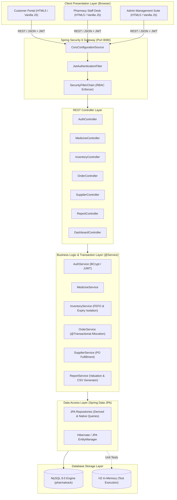
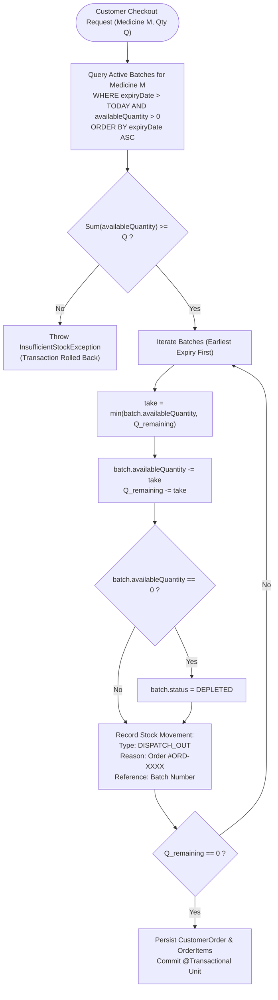
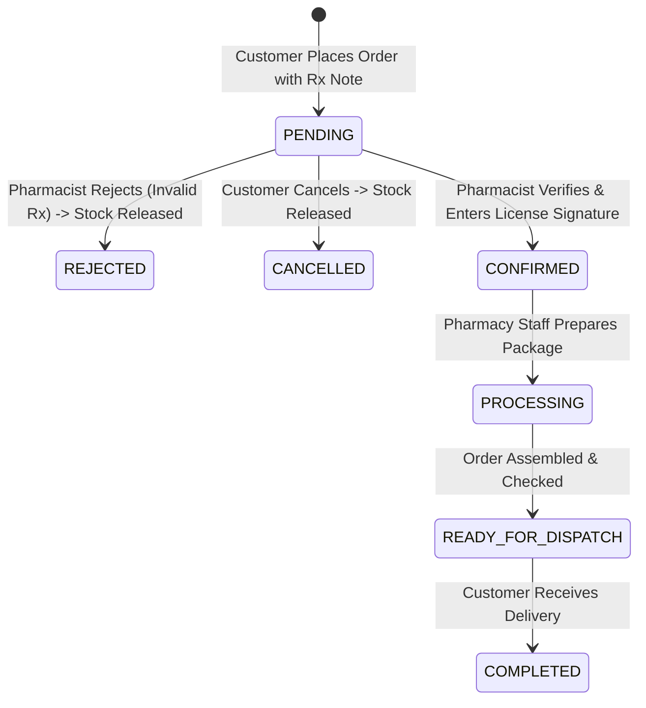

# PharmaTrack – Architecture & System Design Document

This document provides a comprehensive technical overview of the architecture, algorithmic design, security filter pipeline, and inventory safety workflows implemented in **PharmaTrack – Smart Pharmacy Inventory & Expiry Management System**.

---

## 1. High-Level System Architecture

PharmaTrack follows a decoupled, **N-Tier Layered Architecture** with strict separation of concerns across presentation, security, business logic, data persistence, and relational storage.



---

## 2. Spring Security 6 & Stateless JWT Pipeline

PharmaTrack uses stateless JSON Web Token (JWT) authentication, ensuring zero server-side session memory consumption and seamless scalability.

```mermaid
sequenceDiagram
    autonumber
    actor User as User / Client Browser
    participant Filter as JwtAuthenticationFilter
    participant TokenProv as JwtTokenProvider
    participant SecCtx as SecurityContextHolder
    participant Endpoint as REST Controller (@PreAuthorize)

    User->>Filter: HTTP Request (Header: Authorization Bearer <token>)
    alt Bearer Token Present & Format Valid
        Filter->>TokenProv: validateToken(jwt)
        TokenProv-->>Filter: Valid = true
        Filter->>TokenProv: getUsername(jwt) & getRole(jwt)
        TokenProv-->>Filter: username = 'admin', role = 'ROLE_ADMIN'
        Filter->>SecCtx: setAuthentication(UsernamePasswordAuthToken)
    else No Token or Invalid
        Filter->>Filter: Skip authentication; proceed as Anonymous
    end
    Filter->>Endpoint: Proceed down FilterChain
    alt Authorized Role Matches
        Endpoint-->>User: 200 OK + JSON Response
    else Unauthorized or Role Forbidden
        Endpoint-->>User: 401 Unauthorized / 403 Forbidden (JSON ApiResponse)
    end
```

### Password Protection
- All user passwords are encrypted using **BCrypt** with a salt work factor of 10 (`BCryptPasswordEncoder`).
- Raw passwords never reach the database or log outputs.
- Passwords are validated via `AuthenticationManager.authenticate(...)` during login.

---

## 3. First-Expired, First-Out (FEFO) Inventory Allocation Engine

In pharmaceutical operations, dispensing older active batches before newer batches is vital to prevent medicine degradation and financial loss. PharmaTrack enforces this via an automated **FEFO Allocation Engine**.

### FEFO Allocation Algorithm

When a customer places an order for quantity $Q$ of medicine $M$:

1. **Active & Unexpired Filter**:
   Only batches satisfying the following conditions are considered:
   $$\text{medicine\_id} = M \quad \land \quad \text{status} = \text{'ACTIVE'} \quad \land \quad \text{expiry\_date} > \text{CURRENT\_DATE}() \quad \land \quad \text{available\_quantity} > 0$$
2. **Sort by Expiry Date ASC**:
   Batches are sorted strictly in ascending order of `expiry_date` (soonest expiry first).
3. **Iterative Allocation**:
   For each batch $B_i$ with available quantity $A_i$:
   - Allocate $\text{take} = \min(A_i, Q_{\text{remaining}})$.
   - Decrement batch stock: $A_i \leftarrow A_i - \text{take}$.
   - If $A_i = 0$, update batch status to `'DEPLETED'`.
   - Create `OrderItem` pointing to batch $B_i$ with quantity $\text{take}$.
   - Create an audit log in `stock_movements` with `movement_type = 'DISPATCH_OUT'` or `'RESERVED'`.
   - Decrement $Q_{\text{remaining}} \leftarrow Q_{\text{remaining}} - \text{take}$.
   - If $Q_{\text{remaining}} == 0$, terminate loop.
4. **Sufficiency Check**:
   If $Q_{\text{remaining}} > 0$ after checking all eligible batches, roll back the transaction and throw `InsufficientStockException`.



---

## 4. Stock Movement Audit State Machine

Every modification to inventory quantity—without exception—is recorded in the append-only `stock_movements` table for compliance and forensic auditing.

| Movement Type | Quantity Sign | Description / Trigger |
|:---|:---:|:---|
| `PURCHASE_IN` | $+$ | Stock received from a supplier purchase order (`PurchaseOrder` marked as `RECEIVED`). |
| `DISPATCH_OUT` | $-$ | Customer order successfully checked out and allocated from batch. |
| `RESERVED` | $-$ | Stock held during pending order verification. |
| `RELEASED` | $+$ | Customer cancels an order, or pharmacist rejects order; stock returned to original batch. |
| `DAMAGE_LOSS` | $-$ | Pharmacist reports broken vials, damaged seals, or temperature excursion. |
| `EXPIRED_DISPOSAL` | $-$ | Expired batch removed from active warehouse floor and destroyed. |
| `AUDIT_CORRECTION` | $\pm$ | Physical shelf inventory count discrepancy adjusted with mandatory justification. |

---

## 5. Prescription-Required Verification Safety Flow

For controlled substances and schedule medicines (`prescription_required = true`), the system enforces a strict verification gate before order progression.



- When status is transitioned to `CANCELLED` or `REJECTED`, the system automatically invokes `OrderService.restoreOrderStock(order)` which reverses the exact quantities back to their respective batch IDs and writes audit records (`RELEASED`).

---

## 6. Concurrency & Transaction Management

- **Database Isolation Level**: `READ_COMMITTED` on MySQL InnoDB engine.
- **Service Layer `@Transactional`**:
  All checkout, restocking, and stock adjustment methods are annotated with `@Transactional(rollbackFor = Exception.class)`.
  If an exception occurs mid-allocation, Hibernate rolls back all modified entities, leaving inventory perfectly consistent.
- **Foreign Key Cascade Protection**:
  Foreign keys prevent deletion of medicines that have existing batches, purchase order items, or order fulfillment records. Soft deactivation (`is_active = false`) is used instead.
