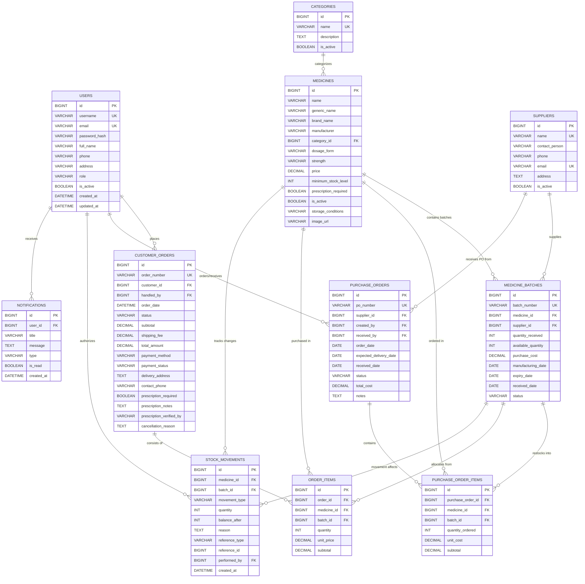

# PharmaTrack – Database Architecture & Entity-Relationship (ERD) Specification

This document provides complete documentation of the normalized MySQL database schema (`pharmatrack`), entity relationships, field definitions, indexing strategies, and relational constraints.

---

## 1. Entity-Relationship Diagram (ERD)



---

## 2. Table Dictionaries & Field Specifications

### 2.1 `users`
Stores system accounts for Administrators, Pharmacy Staff, and Customers.

| Column | Type | Constraints | Description |
|:---|:---|:---|:---|
| `id` | BIGINT | PRIMARY KEY, AUTO_INCREMENT | Unique identifier for user |
| `username` | VARCHAR(50) | NOT NULL, UNIQUE | Login handle (e.g. `admin`) |
| `email` | VARCHAR(100) | NOT NULL, UNIQUE | Notification and login email |
| `password_hash`| VARCHAR(255) | NOT NULL | BCrypt password hash (`$2a$10$...`) |
| `full_name` | VARCHAR(100) | NOT NULL | User's full display name |
| `phone` | VARCHAR(20) | NULL | Primary contact phone |
| `address` | TEXT | NULL | Shipping or physical address |
| `role` | VARCHAR(30) | NOT NULL | `ROLE_ADMIN`, `ROLE_STAFF`, `ROLE_CUSTOMER` |
| `is_active` | BOOLEAN | NOT NULL, DEFAULT TRUE | Soft delete / activation toggle |
| `created_at` | DATETIME | NOT NULL | Audit timestamp of account creation |
| `updated_at` | DATETIME | NOT NULL | Audit timestamp of last record update |

### 2.2 `categories`
Therapeutic classifications of pharmaceuticals (e.g., Antibiotics, Analgesics, Cardiovascular).

| Column | Type | Constraints | Description |
|:---|:---|:---|:---|
| `id` | BIGINT | PRIMARY KEY, AUTO_INCREMENT | Category identifier |
| `name` | VARCHAR(100) | NOT NULL, UNIQUE | Category name |
| `description` | TEXT | NULL | Clinical and pharmacological scope |
| `is_active` | BOOLEAN | NOT NULL, DEFAULT TRUE | Category status |

### 2.3 `medicines`
Master drug catalog storing product identities, retail prices, and safety thresholds.

| Column | Type | Constraints | Description |
|:---|:---|:---|:---|
| `id` | BIGINT | PRIMARY KEY, AUTO_INCREMENT | Master medicine identifier |
| `name` | VARCHAR(150) | NOT NULL | Commercial trade / brand name |
| `generic_name` | VARCHAR(150) | NOT NULL | Active pharmaceutical ingredient (API) |
| `brand_name` | VARCHAR(100) | NULL | Marketing brand name |
| `manufacturer` | VARCHAR(100) | NOT NULL | Pharmaceutical manufacturer |
| `category_id` | BIGINT | NOT NULL, FK(`categories.id`) | Foreign key to drug classification |
| `dosage_form` | VARCHAR(50) | NOT NULL | Tablet, Capsule, Syrup, Injection, etc. |
| `strength` | VARCHAR(50) | NOT NULL | Concentration (e.g. 500mg, 10mg/ml) |
| `price` | DECIMAL(10,2)| NOT NULL, CHECK $\ge 0$ | Retail dispensing price per unit |
| `minimum_stock_level` | INT | NOT NULL, DEFAULT 10 | Threshold triggering Low-Stock alerts |
| `prescription_required` | BOOLEAN | NOT NULL, DEFAULT FALSE | Whether an Rx is legally required |
| `is_active` | BOOLEAN | NOT NULL, DEFAULT TRUE | Active listing in catalog |
| `storage_conditions` | VARCHAR(100) | NULL | Room Temp (15-25°C), Refrigerated (2-8°C) |
| `image_url` | VARCHAR(255) | NULL | Product thumbnail or placeholder image |

### 2.4 `medicine_batches`
Physical inventory batches with distinct manufacturing dates, expiry dates, and costs.

| Column | Type | Constraints | Description |
|:---|:---|:---|:---|
| `id` | BIGINT | PRIMARY KEY, AUTO_INCREMENT | Internal batch tracking ID |
| `batch_number` | VARCHAR(50) | NOT NULL, UNIQUE | Regulatory lot/batch code printed on box |
| `medicine_id` | BIGINT | NOT NULL, FK(`medicines.id`) | Master product reference |
| `supplier_id` | BIGINT | NOT NULL, FK(`suppliers.id`) | Supplier sourcing reference |
| `quantity_received` | INT | NOT NULL, CHECK $\ge 0$ | Original count received upon delivery |
| `available_quantity` | INT | NOT NULL, CHECK $\ge 0$ | Physical units remaining on shelf |
| `purchase_cost` | DECIMAL(10,2)| NOT NULL | Wholesale procurement cost per unit |
| `manufacturing_date` | DATE | NOT NULL | Date synthesized / packaged |
| `expiry_date` | DATE | NOT NULL | Legal expiry deadline (FEFO sort key) |
| `received_date` | DATE | NOT NULL | Date accepted into inventory |
| `status` | VARCHAR(30) | NOT NULL | `ACTIVE`, `DEPLETED`, `EXPIRED`, `QUARANTINED` |

### 2.5 `suppliers`
Approved pharmaceutical wholesalers and distributors.

| Column | Type | Constraints | Description |
|:---|:---|:---|:---|
| `id` | BIGINT | PRIMARY KEY, AUTO_INCREMENT | Supplier ID |
| `name` | VARCHAR(150) | NOT NULL, UNIQUE | Legal corporate entity name |
| `contact_person`| VARCHAR(100) | NULL | Sales manager or account representative |
| `phone` | VARCHAR(25) | NULL | Order desk hotline |
| `email` | VARCHAR(100) | NOT NULL, UNIQUE | Invoicing and PO dispatch email |
| `address` | TEXT | NULL | Distribution center address |
| `is_active` | BOOLEAN | NOT NULL, DEFAULT TRUE | Operational status |

### 2.6 `customer_orders` & `order_items`
Encapsulates customer checkout records and batch-level fulfillment items.

- `customer_orders` fields: `order_number` (`ORD-YYYYMMDD-XXXX`), `customer_id` (FK), `handled_by` (FK Staff/Admin), `order_date`, `status` (`PENDING`, `CONFIRMED`, `PROCESSING`, `READY_FOR_DISPATCH`, `COMPLETED`, `CANCELLED`, `REJECTED`), `subtotal`, `shipping_fee`, `total_amount`, `payment_method`, `delivery_address`, `prescription_notes`, `prescription_verified_by`.
- `order_items` fields: `order_id` (FK), `medicine_id` (FK), `batch_id` (FK to specific batch from which stock was deducted via FEFO), `quantity`, `unit_price`, `subtotal`.

### 2.7 `stock_movements`
Immutable, append-only chronological log of all stock changes for complete auditability.

- Fields: `id`, `medicine_id` (FK), `batch_id` (FK), `movement_type` (`PURCHASE_IN`, `DISPATCH_OUT`, `RESERVED`, `RELEASED`, `DAMAGE_LOSS`, `EXPIRED_DISPOSAL`, `AUDIT_CORRECTION`), `quantity`, `balance_after`, `reason`, `reference_type`, `reference_id`, `performed_by` (FK to `users`), `created_at`.

---

## 3. Database Normalization Analysis

The database adheres strictly to **Third Normal Form (3NF)**:

1. **First Normal Form (1NF)**:
   - All columns contain atomic, indivisible values.
   - Each record is uniquely identifiable by a primary key (`id`).
   - No repeating groups or comma-separated lists (e.g., order items are stored in a dedicated `order_items` table instead of an array inside `customer_orders`).

2. **Second Normal Form (2NF)**:
   - Schema is in 1NF.
   - All non-key attributes are fully functionally dependent on the entire primary key. In junction tables like `order_items` and `purchase_order_items`, attributes like `quantity` and `unit_price` depend directly on the item's surrogate primary key.

3. **Third Normal Form (3NF)**:
   - Schema is in 2NF.
   - No transitive dependencies exist. For example, `category_name` is not stored in the `medicines` table; instead, `category_id` references the `categories` table. Similarly, customer delivery address at the time of order is snapshotted in `customer_orders` to preserve historical order records even if the customer updates their profile.

---

## 4. Performance Indexes

To ensure high-throughput queries during active pharmacy operations:

```sql
-- Fast search queries by medicine name and category
CREATE INDEX idx_med_name ON medicines (name);
CREATE INDEX idx_med_category ON medicines (category_id);

-- Optimized FEFO batch lookup: active, unexpired, earliest expiry first
CREATE INDEX idx_batch_fefo ON medicine_batches (medicine_id, status, expiry_date, available_quantity);

-- Fast order history retrieval per customer
CREATE INDEX idx_orders_customer ON customer_orders (customer_id, order_date);

-- Rapid audit trail filtering by medicine and batch
CREATE INDEX idx_movement_med_batch ON stock_movements (medicine_id, batch_id, created_at);
```
